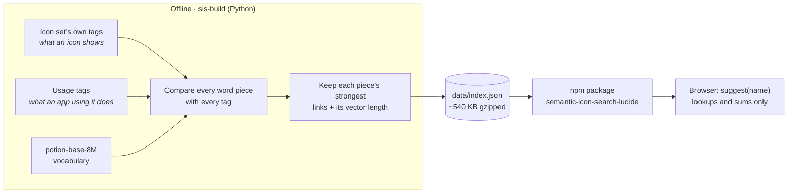
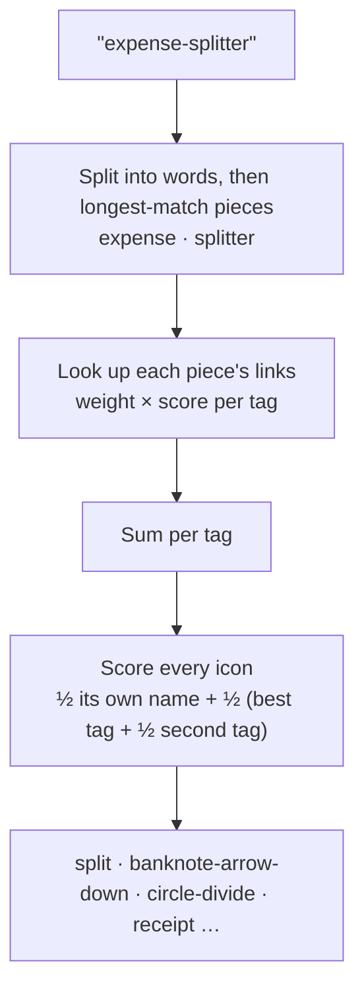

# semantic-icon-search

Suggest icons for a name by meaning — `help` → life-buoy, `podcast-studio` →
mic, `triage` → inbox — entirely in the browser, with no model and no network
call at runtime.

<picture>
  <source media="(prefers-color-scheme: dark)" srcset="docs/visuals/suggestions-dark.svg">
  
</picture>

<sub>Real output from `semantic-icon-search-lucide`, drawn as app tiles. The names were picked to show
its range; the [measured hit rates](#lucide-results) are below, misses included.</sub>

```js
import { suggest } from "semantic-icon-search-lucide"

suggest("plant-diary", { limit: 5 })
// → ["notebook-pen", "plant-pot", "sprout", "flower", "flower-2"]
```

## How it works

[Model2Vec](https://github.com/MinishLab/model2vec) static embeddings
(`minishlab/potion-base-8M`) are an average of word-piece vectors, so a name's
similarity to a tag splits into a sum over its pieces. Offline, the builder
compares every word piece in the model's vocabulary with every tag of an icon
set and keeps each piece's strongest links plus its vector length. The browser
only splits the name and adds up links: the same order the model would give,
from a lookup table.



At runtime a name goes through four cheap steps:



### Three things that made it work

- **Usage tags.** Icon sets tag what an icon *shows* (`syringe`: needle,
  medicine); app names say what an app *does* (`glucose-log`). Each icon also
  gets ~10 tags written offline about what it would be used for. They lifted a
  fair icon into the top 12 for 70% of test names, up from 63%.
  See [docs/usage-tags.md](docs/usage-tags.md).
- **Whole-word rows.** A tag word the model splits into pieces gets a row of
  its own, so it doesn't inherit its pieces' neighbours:

  <picture>
    <source media="(prefers-color-scheme: dark)" srcset="docs/visuals/triage-dark.svg">
    
  </picture>
- **Scoring on name plus top tags.** An icon scores half on its own name and
  half on its best tag plus half-weight on its second. Scoring only the single
  best tag let icons with long, loose tag lists win too often.

## Packages

| Package | What |
|---|---|
| [`semantic-icon-search`](packages/semantic-icon-search) | The runtime: `createIconSearch(index)`, zero dependencies |
| [`semantic-icon-search-lucide`](packages/semantic-icon-search-lucide) | Index for Lucide 1.63.0 (1,924 icons, ~540 KB gzipped) |

## Lucide results

Scored on 182 labelled sprite names written blind by a separate model, held
out from tuning:

| Top 1 | Top 3 | Top 6 | Top 12 | Top 24 |
|---|---|---|---|---|
| 42% | 59% | 70% | 77% | 81% |

"Fair" is generous by design: any icon a person could reasonably pick. Treat
the top pick as a default and the next dozen as the real product: a picker
that shows a row of suggestions, not an auto-assigner.

## Adding an icon set

1. Create `iconsets/<name>/iconset.json` (fields are documented in
   `builder/semantic_icon_search_build/iconsets.py`), pointing `tags.url` at
   the set's own `{icon: [tags]}` JSON.
2. Optionally write `usage-tags.json` ([docs/usage-tags.md](docs/usage-tags.md))
   and labelled `eval/dev.tsv` / `eval/test.tsv` files (`name<TAB>fair icons`).
3. Scaffold `packages/semantic-icon-search-<name>` like the Lucide package.
4. Build, check and test:

```sh
cd builder
uv run sis-build build <name>     # writes data/index.json and test/parity.json
uv run sis-build eval <name>      # tune on dev; score test once at the end
cd .. && npm test
npm run visuals                   # redraw the README figures
```

## Licences

Code is MIT. Lucide's tags and icons are from `lucide-static` (ISC). The
embedding model is `minishlab/potion-base-8M` (MIT); only derived link scores
ship.
