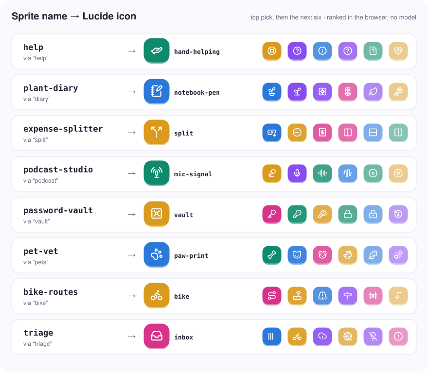
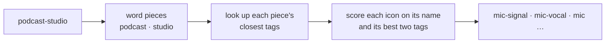

# semantic-icon-search

Suggest icons for a name by what it means. Type `podcast-studio` and get a
microphone, `password-vault` and get a vault and some keys. It runs in the
browser with no model, no API key and no network request.

<picture>
  <source media="(prefers-color-scheme: dark)" srcset="docs/visuals/suggestions-dark.svg">
  
</picture>

It's built for icon pickers: a user names a project, a workspace or an app, and
you show the icons that fit before they start scrolling through two thousand of
them.

## Install

```sh
npm install semantic-icon-search-lucide
```

The package carries its own index for [Lucide](https://lucide.dev) 1.63.0. It
doesn't include the icons, so render them however you already do
(`lucide-react`, `lucide-static`, a sprite).

## Usage

```js
import { suggest } from "semantic-icon-search-lucide"

suggest("plant-diary", { limit: 5 })
// ["notebook-pen", "plant-pot", "sprout", "flower", "flower-2"]
```

For a picker you usually want the reason as well, so you can label each
suggestion:

```js
import { search } from "semantic-icon-search-lucide"

search.rank("plant-diary", { limit: 3 })
// [
//   { icon: "notebook-pen", score: 0.257, tag: "diary" },
//   { icon: "plant-pot",    score: 0.212, tag: "plant" },
//   { icon: "sprout",       score: 0.212, tag: "plant" },
// ]
```

Names are split on anything that isn't a letter, so `plant-diary`,
`plant_diary` and `Plant Diary` all give the same answer. A name with no
letters in it returns an empty list.

### Loading it lazily

The index is about 540 KB gzipped, which is a lot to put in your main bundle
for a picker that most users open once. Import it when the picker opens:

```js
const { suggest } = await import("semantic-icon-search-lucide")
```

Or fetch the JSON yourself and hand it to the runtime:

```js
import { createIconSearch } from "semantic-icon-search"

const index = await fetch("/icons/lucide-index.json").then((r) => r.json())
const search = createIconSearch(index)
```

The file to serve is `semantic-icon-search-lucide/index.json`.

## API

### `suggest(name, options?)`

Returns icon names, best first. Only from `semantic-icon-search-lucide`.

### `createIconSearch(index)`

Builds a search from an index. Only from `semantic-icon-search`.

### `search.rank(name, options?)`

Returns `{ icon, score, tag }[]`, best first.

| Option | Default | |
|---|---|---|
| `limit` | `Infinity` | Maximum number of results. |
| `all` | `false` | Include icons with no link to the name, after the matches, in library order. |

`tag` is the icon tag that matched most strongly, or `null`. Scores only
compare results from the same query.

### `search.pieces(name)`

Shows how a name was split for lookup, as `{ piece, known }[]`. Handy when a
result looks odd: `supernote` is read as `super` + `##note`, which is why it
leans towards banknotes.

### `search.icons`, `search.iconset`, `search.version`

The icon names in library order, and which icon set and version the index was
built for.

## Accuracy

We tested it on 182 app names written by someone who never saw the ranker,
each labelled with every Lucide icon a person could reasonably pick:

| Fair icon at #1 | in top 3 | in top 6 | in top 12 | in top 24 |
|---|---|---|---|---|
| 42% | 59% | 70% | 77% | 81% |

So the first suggestion is a good default, not an answer. Show a row of
eight or twelve and let people choose.

It does best with ordinary English words (`budget`, `pet-vet`,
`weather-station`). Brand names, abbreviations and made-up words are a
different story. `kasm` gets read as `ka` + `##sm` and comes back with a leafy
green and a bomb. The scores don't reliably flag this, so keep the user in
charge of the final pick.

## Performance

In Node 24 on an M-series Mac, importing and parsing the Lucide index takes
about 60 ms and each query about 1 ms. Nothing is cached between queries, so
ranking as the user types is fine.

## Icon sets

| Package | Icon set | Icons | Index (gzipped) |
|---|---|---|---|
| `semantic-icon-search-lucide` | Lucide 1.63.0 | 1,924 | ~540 KB |

Indexes are built per icon set version. Lucide adds icons regularly, and any
icon newer than the index won't appear in results until the index is rebuilt.

Want another set? Indexes come from a small Python builder in this repo; see
[Adding an icon set](#adding-an-icon-set).

## How it works

A static embedding model ([Model2Vec](https://github.com/MinishLab/model2vec)'s
`potion-base-8M`) gives every word piece a vector, and a phrase's vector is the
average of its pieces. That means a name's similarity to an icon's tags can be
worked out piece by piece. The builder does the expensive part ahead of time
and keeps, for every piece, the handful of tags it is closest to. In the
browser, ranking is a table lookup and some addition.



Each icon has Lucide's own tags plus about ten more saying what kind of app
would use it, so `syringe` also knows about diabetes and vaccinations.
[docs/how-it-works.md](docs/how-it-works.md) has the details and the
trade-offs.

## Adding an icon set

You need Python with [uv](https://docs.astral.sh/uv/) and Node 22 or newer.

1. Add `iconsets/<name>/iconset.json` with the set's version and the URL of
   its tags (an `{icon: [tags]}` JSON file). The fields are listed at the top
   of `builder/semantic_icon_search_build/iconsets.py`.
2. Optionally add `usage-tags.json` and labelled test names. They make a big
   difference; [docs/usage-tags.md](docs/usage-tags.md) explains how to write
   them.
3. Copy `packages/semantic-icon-search-lucide` to
   `packages/semantic-icon-search-<name>` and rename it.
4. Build and test:

```sh
cd builder
uv run sis-build build <name>    # writes the package's index
uv run sis-build eval <name>     # scores it on your labelled names
cd .. && npm test
```

## License

MIT. Lucide's icons and tags are ISC, from `lucide-static`. The index is
derived from `minishlab/potion-base-8M` (MIT).
