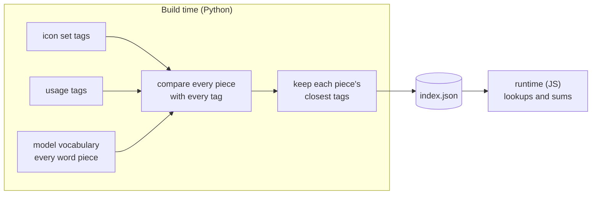
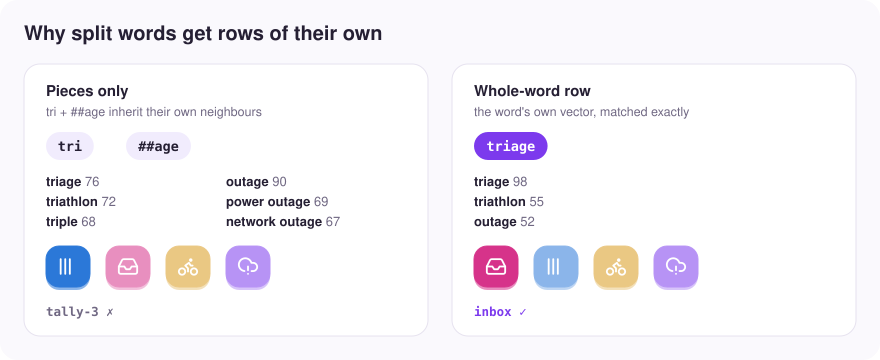

# How it works

The short version: a small embedding model does all of its work at build time,
and what ships is a lookup table.



## Why a table is enough

[Model2Vec](https://github.com/MinishLab/model2vec) models are static: a word
piece always has the same vector, and a phrase's vector is the average of its
pieces. So the similarity between a name and a tag is a sum of
piece-by-tag similarities, and those can be computed ahead of time.

The builder takes every piece in `potion-base-8M`'s vocabulary, scores it
against every tag in the icon set, and keeps up to six of its strongest links.
It also stores how long each piece's vector is. The model makes common words
like `help` or `home` shorter so they count for less, and the runtime needs that
weight to add pieces up the way the model would.

At runtime the name is split the way the model splits it (longest match
first), each piece's links are added into per-tag totals, and every icon gets a
score. That score is half the icon's own name and half its best tag, with its
second-best tag counting for half as much again. Using two tags stops an
icon from winning on one loose tag. Weighting the second one down stops an
icon with three vague matches from beating one with an exact match.

Throwing away all but the strongest links is what keeps the index small. It's
also lossy, and the ranking you get is close to the full model's but not the
same.

## Split words

The model doesn't know every word. `triage` isn't in its vocabulary, so it
becomes `tri` + `##age`, and those pieces bring their own associations with
them: `tri` is close to "triple" and "third", `##age` to "outage".

<picture>
  <source media="(prefers-color-scheme: dark)" srcset="visuals/triage-dark.svg">
  
</picture>

So any word that appears in an icon's tags and gets split this way gets a row
of its own, built from the whole word's vector. Because the runtime splits
longest-match first, it picks up the whole word before trying its pieces. That
adds about 40 KB to the Lucide index.

Words that aren't in any tag still go through as pieces. That's where most of
the odd results come from (`supernote` → banknotes).

## Usage tags

Icon sets describe what an icon looks like. Lucide tags `syringe` with things
like "needle" and "medicine". App names describe what an app does:
`glucose-log`, `vaccine-clinic`. The gap between the two is where most misses
used to come from.

So every icon also gets about ten tags describing what kind of app would use
it, written once by a language model and checked in as
`iconsets/<name>/usage-tags.json`. On the Lucide test names they moved a fair
icon into the top 12 for 70% of names, from 63% with Lucide's tags alone.
Adding dictionary synonyms instead made no measurable difference, presumably
because the embedding model already knows synonyms.

[usage-tags.md](usage-tags.md) has the prompt and the rules.

## Measuring it

Each icon set can ship two files of labelled names, `eval/dev.tsv` and
`eval/test.tsv`, one name per line with every icon a person could reasonably
pick. The ones for Lucide were written by a separate model that never saw the
ranker or the tags. Tune settings against `dev`. Look at `test` rarely, or it
stops telling you anything.

```sh
cd builder && uv run sis-build eval lucide --split dev
```

## Settings

Per icon set, in `iconset.json`:

| Setting | Lucide | What it does |
|---|---|---|
| `index.linksPerPiece` | 6 | Tags kept per word piece. The main size/quality dial. |
| `index.linkMin` | 45 | Minimum score (cosine above the piece's median, ×100) for links after the first. |
| `index.bestMin` | 30 | Minimum score for a piece's single best link. |
| `index.wholeWords` | true | Rows for split tag words. |
| `rank.nameWeight` | 0.5 | Share of an icon's score from its own name. |
| `rank.secondTagWeight` | 0.5 | Weight of the second-best tag against the best. |

Before whole-word rows were added, Lucide's index was about 400 KB with 3
links per piece, 500 KB with 6 and 625 KB with 8. Going past 6 barely moved
the top-12 hit rate.
